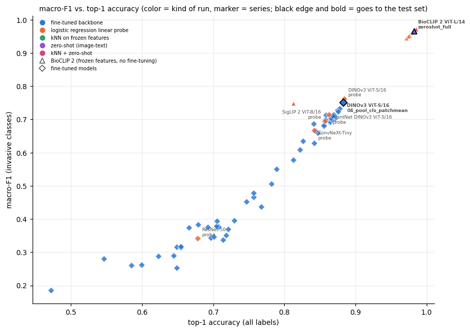
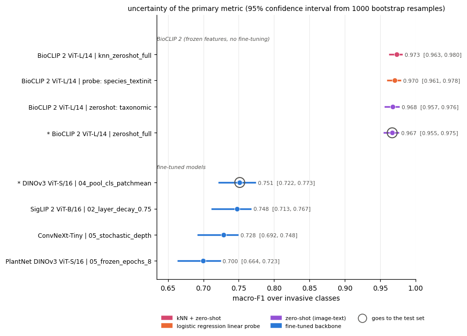
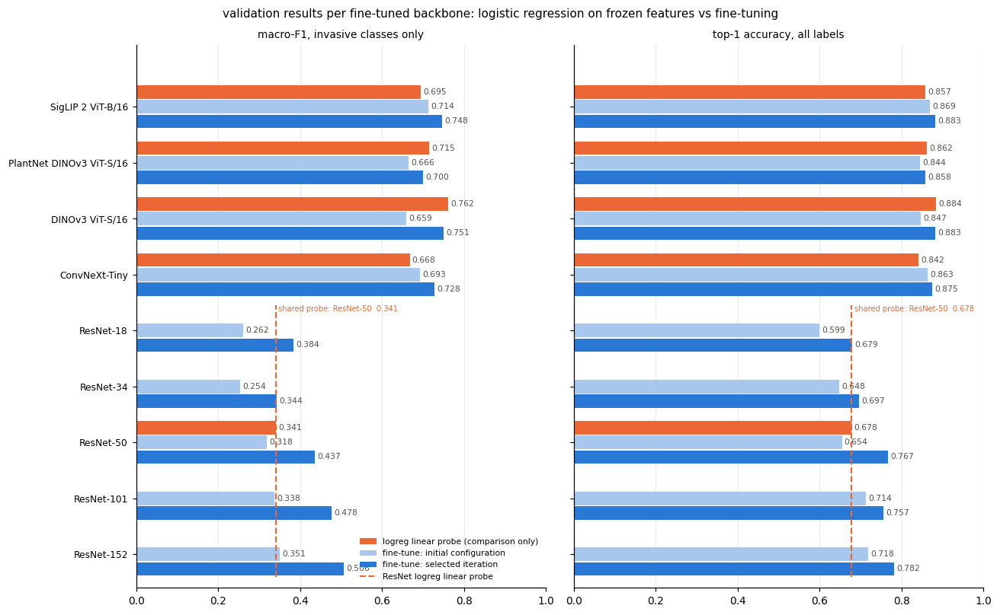
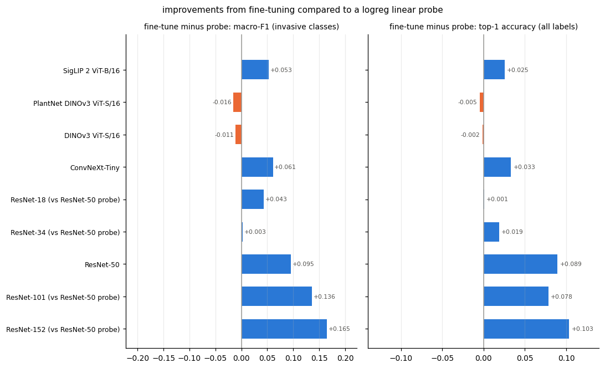
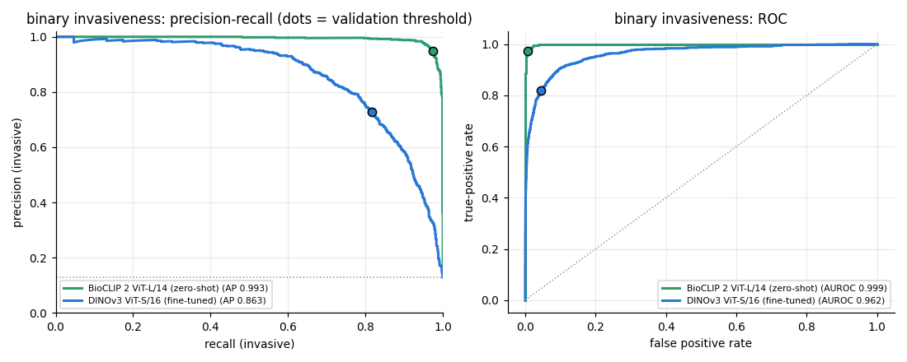
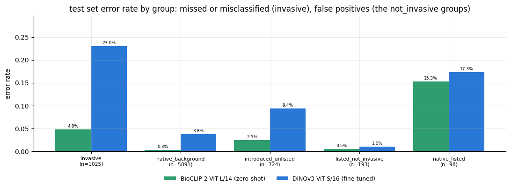
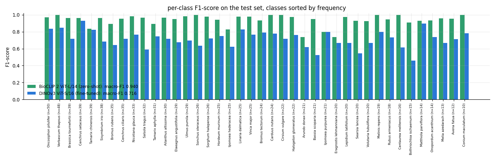

# Invasive Plant Identification from Citizen-Science Photos

A fine-tuned vision model that flags invasive plant species in iNaturalist photos from the Desert Southwest.

**[Erdos Institute](https://www.erdosinstitute.org) Deep Learning Project, Fall 2026**

**Team: Craig Corsi, Jay Desai, Rachel Neville, and Apostolos Zournas**
---


## Overview

**Problem.** Invasive plants degrade ecosystems across the Desert Southwest. They displace native vegetation, change fire regimes, and disrupt food webs. Management costs rise sharply once an infestation is established, so identifying small, localized populations is a more cost effective management strategy. Field surveys cannot cover the land at the needed scale. Citizen-science platforms such as iNaturalist produce more observations.

**Opportunity.** iNaturalist collects many community photos from volunteers.

**What we built.** A classifier that looks at a plant photo from the Desert Southwest and either names one of **40 invasive species** or answers `not_invasive`. We compared nine pretrained vision backbones fine-tuned on our data with BioCLIP 2, a large biology-specific image–text model used without any training (zero-shot), and tested the best of each once on photos uploaded after the pretrained models' data was collected, from photographers absent from training.

## Data

- **Source:** [iNaturalist](https://www.inaturalist.org/) research-grade observations, Desert Southwest region (place_id 118341: Arizona, New Mexico, eastern California). Photos licensed CC0, CC BY or CC BY-NC by their photographers.
- **Invasive species list:** invasive and noxious-weed species from published lists (the Southwest Vegetation Management Association, the National Park Service Southwest watchlist, Cal-IPC High and Moderate, and state and USDA noxious-weed lists). A plant counts as invasive when it is non-native and on at least one ecological list; exceptions are in [`label_policy.py`](src/invasive_clf/data/label_policy.py). See [`notebooks/data/`](notebooks/data/).
- **Classes:** 40 invasive species with enough iNaturalist photos, each its own class, plus `not_invasive`. The `not_invasive` photos are 401 other species of four kinds: native background species, introduced species not on any list, listed species that are not invasive here, and native species on a watch list.
- **Splits:**

| split | photos | invasive | species |
| --- | --- | --- | --- |
| train | 7,342 | 1,186 | 441 |
| val | 3,228 | 982 | 441 |  |
| test | 7,931 | 1,025 | 441 |
| test_unseen | 792 | 0 | 30 |

The `test_unseen` set is an additional sample of observations for species never seen in training, all with label `not_invasive`. Each photographer appears in only one split, and val, test, and test_unseen only hold photos uploaded on or after 2025-07-01, so the pretrained models we start from cannot have seen them. The split tables in [`data/splits/`](data/README.md) define the dataset exactly.

The images are **not** included in this repository. See [Reproducing the results](#reproducing-the-results) for download information.

## Method

**Classification objective.** All trained models use a multilabel classification head on the 40 invasive targets. A photo is predicted as the most probable species when that probability reaches a threshold *t*, and as `not_invasive` otherwise; *t* is tuned on validation to maximize the primary metric. Multilabel classification is used as opposed to multiclass classification, so that models do not attempt to learn features for the pooled `not_invasive` class. The primary metric is **macro-F1 over the 40 invasive species** (every species counts equally, however rare). Model evaluation also takes several other metrics into consideration, primarily **top-1 accuracy over the 41 labels**, but also: macro-AP over invasive species, top-1 and top-3 recall over invasive species, several metrics for the binary classification of `invasive`/`not_invasive` (precision, recall, F1, AP, AUROC), and macro-F1 over all 41 labels.

**Modeling experiment design** ([`notebooks/modeling_experiments/`](notebooks/README.md), notebooks 05–18):

1. **Fine-tuning.** Nine pretrained backbones (ResNet-18 to -152, ConvNeXt-Tiny, DINOv3 ViT-S/16, Pl@ntNet-300K-v2 DINOv3 ViT-S/16, SigLIP 2 ViT-B/16) were fine-tuned with one shared architecture: a few epochs training only a new linear head, then full fine-tuning with AdamW and a 1-cycle cosine schedule, with image transforms, mixed precision and horizontal-flip test-time augmentation. Starting from the same initial configuration, each backbone was improved **one change at a time**, modifying 1-2 hyperparameters. We accepted it if validation macro-F1 clearly improved and other metrics did not drop substantially, or rejected it. Decisions from all 55 fine-tuning runs are recorded in the notebooks.
2. **Baselines.** A logistic regression on the frozen features of each pretrained model (linear probe), to measure what fine-tuning adds. One ResNet-50 baseline was trained for the entire ResNet family. The baselines were for comparison only and were not candidates for the final model. For both DINOv3 models, the baseline scored about as well as fine-tuned models.
3. **BioCLIP 2, frozen.** Zero-shot classification: each photo is evaluated with the text "a photo of *scientific name*", and an invasive species gets the probability of its own name. We also tried training a logistic regression linear probe, k-nearest neighbours on the training photos, and a kNN + zero-shot mix, but accuracy did not improve substantially.

| backbone | parameters | zero-shot predictions | linear probe | best fine-tuned model |
| --- | --- | --- | --- | --- |
| ResNet-18 / 50 / 152 | 11 / 24 / 58 M | — | 0.34 | 0.38 / 0.44 / 0.51 |
| ConvNeXt-Tiny | 28 M | — | 0.67 | 0.73 |
| Pl@ntNet DINOv3 ViT-S/16 | 22 M | — | 0.72 | 0.70 |
| **DINOv3 ViT-S/16** | 22 M | — | 0.76 | **0.75** |
| SigLIP 2 ViT-B/16 | 93 M | — | 0.70 | 0.75 |
| **BioCLIP 2 ViT-L/14** | 304 M | **0.97** | 0.97 | — |

Macro F1-score over the 40 invasive species ([`results/final_selection/backbone_comparison.csv`](results/final_selection/backbone_comparison.csv)).









Fine-tuning produced improvements over the baseline for ResNet50, ConvNeXt-Tiny, and SigLIP 2, but not for DINOv3 or Pl@ntNet DINOv3. This shows that DINOv3 already has a rich feature representation. We also see that Pl@ntNet DINOv3's performance is slightly worse than DINOv3.

**Choosing the two final models** ([notebook 18](notebooks/modeling_experiments/18_final_model_comparison.ipynb)):

- **Fine-tuned:** DINOv3 ViT-S/16 with CLS + patch-mean pooling and 8 frozen epochs ([`configs/dinov3_vits16.yaml`](configs/dinov3_vits16.yaml)). SigLIP 2 was within bootstrap noise of it on
  validation (the paired difference bootstrap 95% confidence interval contains 0) but has four times the parameters, so the smaller model was chosen.
- **BioCLIP 2:** zero-shot over the 4,573-name vocabulary ([`configs/bioclip2_zeroshot.yaml`](configs/bioclip2_zeroshot.yaml)). The kNN + zero-shot mix scored 0.006 higher on validation, within noise, but in a rehearsal with species hidden from the model it flagged 10–15% of the unknown-species photos as invasive, against about 4% for zero-shot alone.

**Test set evaluation** ([notebook 19](notebooks/modeling_experiments/19_final_evaluation.ipynb), [`evaluate.py`](src/invasive_clf/evaluate.py)). The DINOv3 configuration was retrained on the full training set (`train.csv` + `val.csv`) for its full schedule. Both models then scored `test.csv` and `test_unseen.csv` once, at the thresholds tuned on validation (0.14 for DINOv3, 0.06 for BioCLIP 2).

## Results

| | BioCLIP 2 ViT-L/14 (zero-shot) | DINOv3 ViT-S/16 (fine-tuned) |
| --- | --- | --- |
| **Macro-F1 over the 40 invasive species** (primary validation metric) | 0.940 | 0.716 |
| **Top-1 accuracy, 41 labels** (primary KPI) | 0.987 | 0.931 |
| Recall for binary invasiveness | 97.4% | 81.8% |
| Precision for binary invasiveness | 94.9% | 72.9% |
| Accuracy for species unseen during training (`test_unseen.csv`) | 97.1% | 91.8% |
| Parameters | 304 M | 21.6 M |
| Inference time per photo (T4 GPU, with mirror image) | 148 ms | 10.5 ms |

Test set metric evaluation, using the thresholds tuned on validation. Macro-F1 dropped by 0.03 from validation to test for both models, so the DINOv3 model did not overfit the validation set much.

Of these models, DINOv3 balances performance with computational cost having only ~21.6M parameters. BioCLIP 2 without any fine-tuning performs much better but also has ~304M parameters and takes more than 14 times longer for inference.





We see from the above chart that both models struggled with native plants that are on a watch list (15–17% flagged as invasive). DINOv3's accuracy becomes **77.0%** when considering only invasive species.



## Repository structure

```text
.
├── README.md
├── pyproject.toml            # the invasive_clf package and its dependencies (pip install -e .)
├── configs/
│   ├── dataset.yaml          # settings of the dataset build
│   ├── dinov3_vits16.yaml    # the final fine-tuned model
│   └── bioclip2_zeroshot.yaml  # the final zero-shot model
├── data/                     # the dataset manifest (no images): split tables and species lists; see data/README.md
├── notebooks/                # how we got there, read in order; see notebooks/README.md
│   ├── eda/                  # 01–02: preliminary dataset and exploratory analysis
│   ├── data/                 # 03–04: species lists behind the dataset
│   └── modeling_experiments/ # 05–19: model search on the validation set, model choice, the test
├── src/invasive_clf/         # the pipeline
│   ├── data/                 # dataset build, photo download, image cache, labels and augmentation
│   ├── models/               # backbones, classifier head, BioCLIP 2 zero-shot
│   ├── metrics.py            # every metric, shared by all models
│   ├── plots.py
│   ├── train_dinov3.py       # train the fine-tuned model
│   ├── build_bioclip2.py     # build the zero-shot model
│   └── evaluate.py           # the test evaluation
├── tests/                    # CPU smoke tests of the three scripts
└── results/                  # model-selection and test results: tables, figures, metrics; see results/README.md
```

## Reproducing the results

Every step runs from the repository root. The model steps need a GPU (times below are for a Colab T4).

**1. Install.** Python 3.10 or later.

```bash
pip install -e .            # installs the invasive_clf package and its dependencies (see pyproject.toml)
```

The DINOv3 weights are gated on Hugging Face: accept the license on the
[model page](https://huggingface.co/facebook/dinov3-vits16-pretrain-lvd1689m), then log in with `hf auth login`
(or set `HF_TOKEN`). BioCLIP 2 needs no login.

**2. Download the photos** listed in `data/splits/` (about 19,300 photos; see [`data/README.md`](data/README.md)).

```bash
python -m invasive_clf.data.download_images
```

Rebuilding the split itself from iNaturalist is optional: `python -m invasive_clf.data.build_dataset`
(settings in `configs/dataset.yaml`).

**3. The fine-tuned model: DINOv3 ViT-S/16** (settings in `configs/dinov3_vits16.yaml`).

```bash
# optional: the validation run that chose the epoch count and the threshold (train only, scored on val; ~70 min)
python -m invasive_clf.train_dinov3 --config configs/dinov3_vits16.yaml --out-dir runs/dinov3_val --validate
# the final model: train + val, full schedule (~70 min) -> runs/dinov3_final/final.pt
python -m invasive_clf.train_dinov3 --config configs/dinov3_vits16.yaml --out-dir runs/dinov3_final
```

**Or skip the training: download the trained weights** (`final.pt`, 87 MB, the train + val model scored in
`results/final_test/`) from the [v1.0 release](https://github.com/Erdos-Projects/fall-2026-invasive-species/releases/tag/v1.0):

```bash
mkdir -p runs/dinov3_final
curl -L -o runs/dinov3_final/final.pt \
    https://github.com/Erdos-Projects/fall-2026-invasive-species/releases/download/v1.0/final.pt
```

Loading it still needs the Hugging Face login above, because the DINOv3 architecture is built from its model page.

**4. The zero-shot model: BioCLIP 2 ViT-L/14** (settings in `configs/bioclip2_zeroshot.yaml`; nothing is trained).

```bash
# optional: score val and tune the threshold (~20 min)
python -m invasive_clf.build_bioclip2 --config configs/bioclip2_zeroshot.yaml --out-dir runs/bioclip2_val --validate
# the final model: the 4,573-name vocabulary and its text embeddings (a few minutes) -> runs/bioclip2_final/bioclip2_zeroshot.pt
python -m invasive_clf.build_bioclip2 --config configs/bioclip2_zeroshot.yaml --out-dir runs/bioclip2_final
```

**5. The test evaluation**: scores `test.csv` and `test_unseen.csv` once with both models at their validation
thresholds, times them, and writes every table and figure (~25 min).

```bash
python -m invasive_clf.evaluate --dinov3 runs/dinov3_final/final.pt \
    --bioclip2 runs/bioclip2_final/bioclip2_zeroshot.pt --out-dir runs/final_test
```

Either model can be left out. The validation-vs-test table reads the validation metrics in
`results/final_selection/final_models.json`.

**Checking the pipeline without a GPU.** Each step has a smoke test that runs on the CPU in about a minute, with tiny
untrained stand-in models and random photos (no downloads):

```bash
python tests/smoke_test_dinov3.py
python tests/smoke_test_bioclip2.py
python tests/smoke_test_evaluate.py
```

## Acknowledgments

The photos are from [iNaturalist](https://www.inaturalist.org/) and its observers, credited per photo in the
`photo_attribution` column of the split tables. Pretrained models: DINOv3 (Meta AI - [Built with DINOv3](https://ai.meta.com/resources/models-and-libraries/dinov3-license/)), Pl@ntNet's DINOv3 fine-tune,
BioCLIP 2 (Imageomics Institute), SigLIP 2 (Google), and the ResNet and ConvNeXt weights distributed with `timm`;
each is used under the license on its model page. BioCLIP 2 (Gu et al., “BioCLIP 2: Emergent Properties from Scaling Hierarchical Contrastive Learning,” NeurIPS 2025; model imageomics/bioclip-2, MIT License), accessed via Hugging Face and OpenCLIP.
